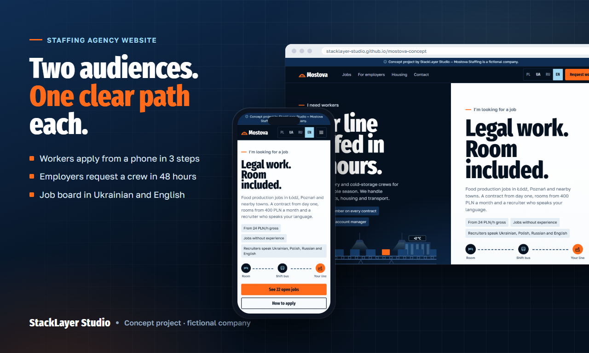
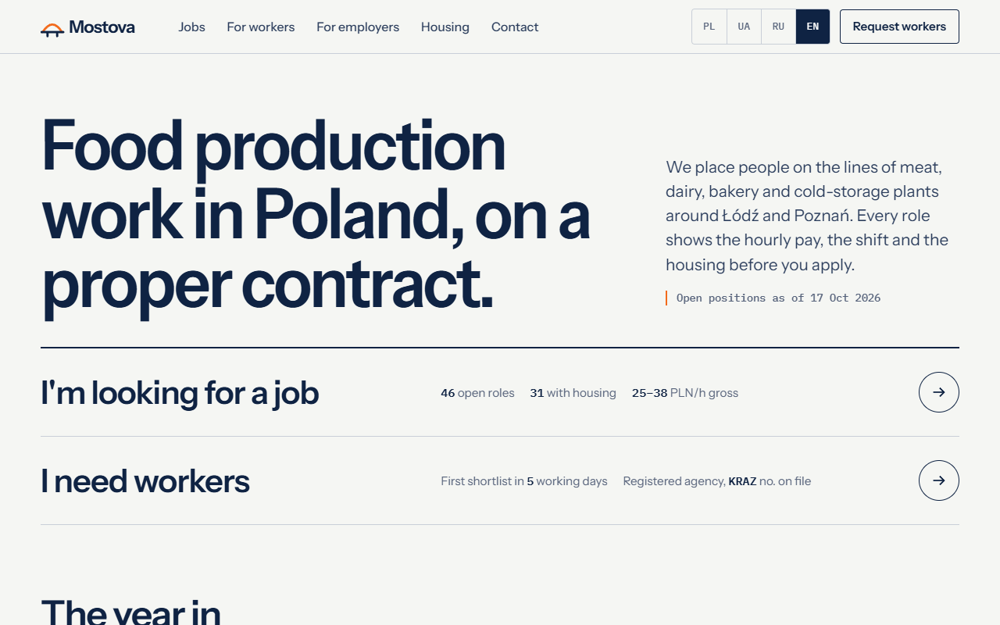
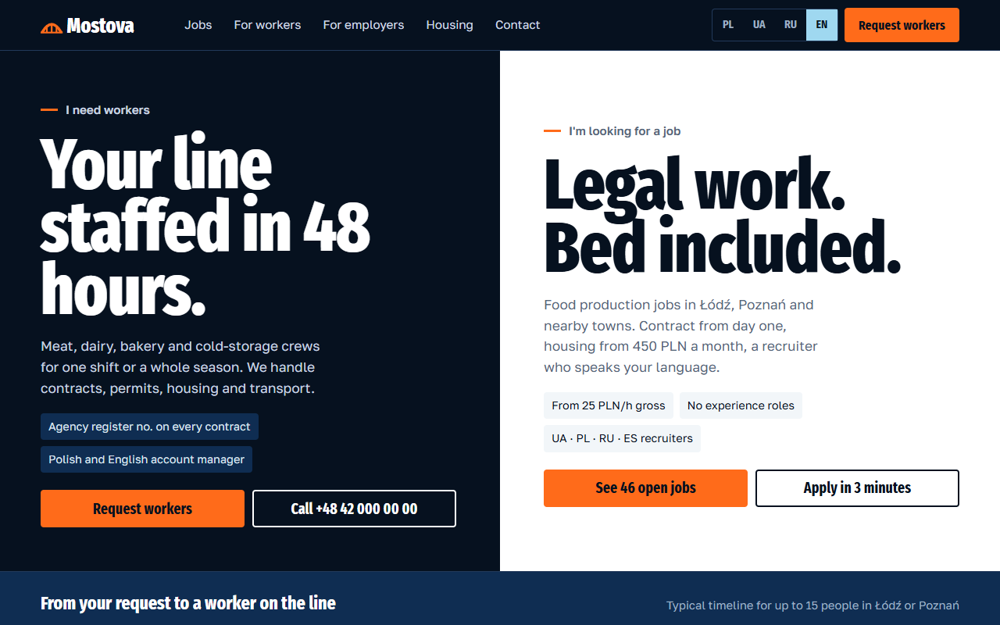
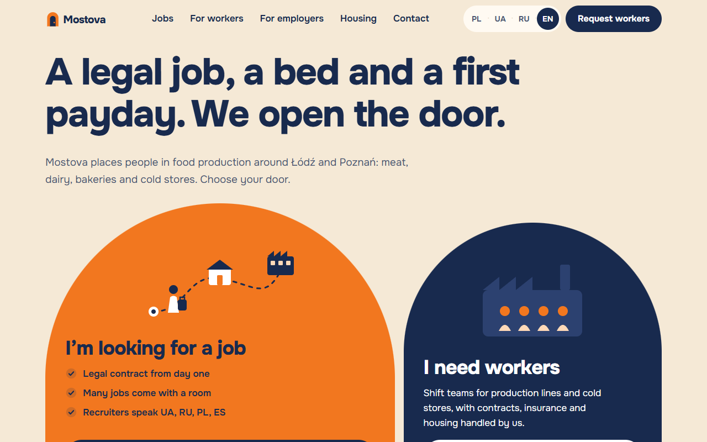
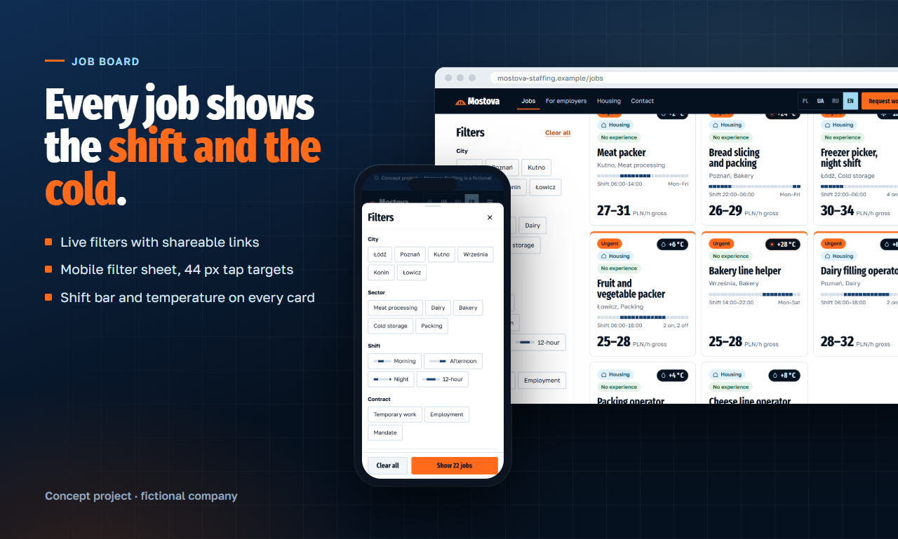
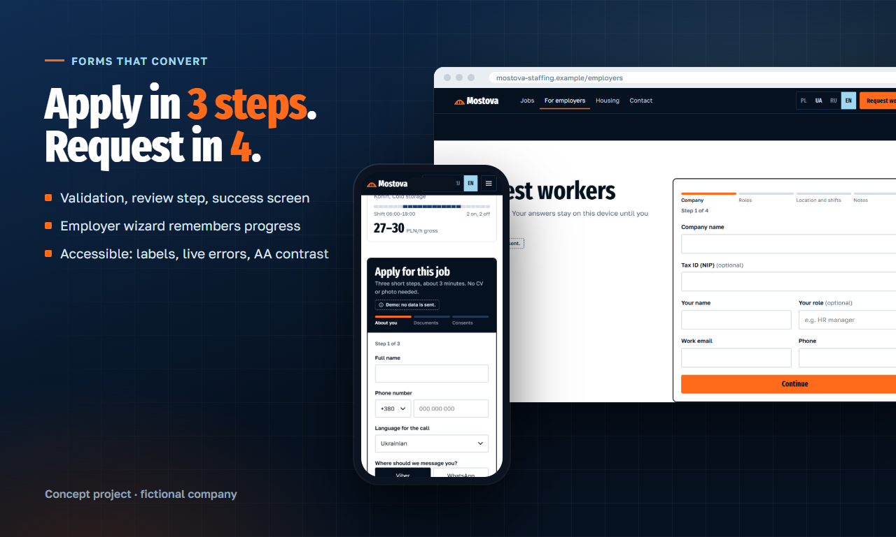

# Case study — Mostova Staffing website (concept)

> Concept project. Mostova Staffing is a fictional company; the brief is modelled on real requests we see from staffing agencies.

**Live demo:** https://stacklayer-studio.github.io/mostova-concept/

## The brief

A staffing agency places workers in Polish food production — meat, dairy, bakeries, cold storage. Its old one-page site brought no candidates, and recruiters juggled applications across chat apps. The new site has to serve two audiences who want opposite things:

| | Workers | Employers |
|---|---|---|
| Device | phone, often slow data | desktop |
| Language | Ukrainian, Polish, Russian, Spanish | Polish, English |
| Wants | a legal job with housing, now | reliable crews fast, no legal risk |
| Success | applies in minutes | sends a staffing request |

## Process

1. **Scope** — pages, features, content owners, milestones and what is *not* included, reviewed by our spec critic before it went out (it caught a GDPR issue: no candidate photos, separate consents).
2. **Three design directions** on the same three pages (Home, Jobs, Job):

| A — Clear Ledger | B — Cold Chain | C — Open Door |
|---|---|---|
|  |  |  |
| calm, report-like, maximum trust | bold, operational, product-specific | warm, worker-first |

3. **Direction B chosen** and taken to an interactive demo.

## What makes it work

- **The product is the visual.** Every job shows a 24-hour shift bar and the temperature you work in (−18 °C cold storage, +28 °C bakery). Workers compare jobs at a glance; employers see an agency that understands their floor.
- **Two paths from the first screen.** "I need workers" and "I'm looking for a job" split the hero; on phones the worker path comes first.

- **A job board people actually use on a phone.** Live filters (city, sector, shift, contract, housing, language at work) in a bottom sheet, removable filter chips, sort, pagination and shareable URLs — a recruiter can send "night shifts with housing in Łódź" as one link.
- **Forms that convert.** A 3-step application (no CV or photo required, review step, clear success screen) and a 4-step employer wizard that remembers progress on the device.

- **Bilingual from day one.** English and Ukrainian with natural copy, `<html lang>` and titles switching with the language; Polish and Russian slots ready.
- **Accessible and light.** Semantic landmarks, labelled fields with live error messages, 44 px tap targets, AA contrast, reduced-motion support; no frameworks, plain HTML/CSS/JS.

## Stack for the production version

Next.js + Payload CMS (recruiter panel: applications inbox, statuses, retention), Postgres and file storage in EU regions, deployed on the client's own accounts.

---

Want something like this for your business? Send a message on Fiverr.
